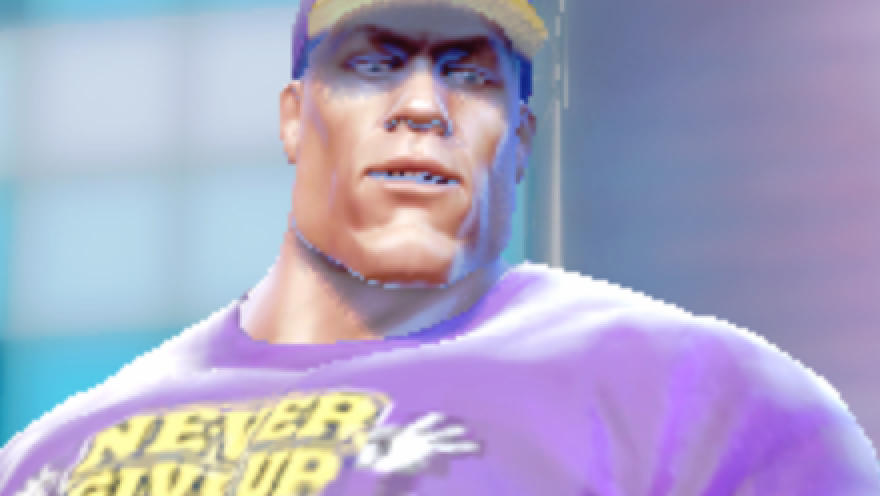
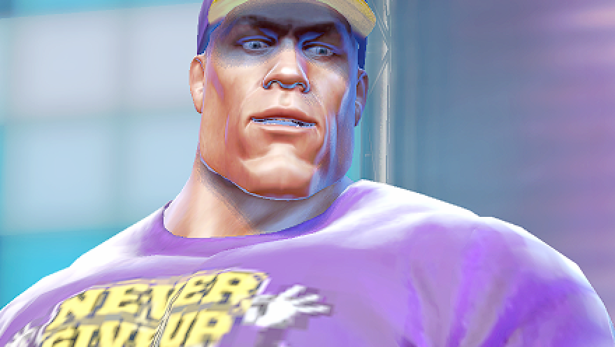
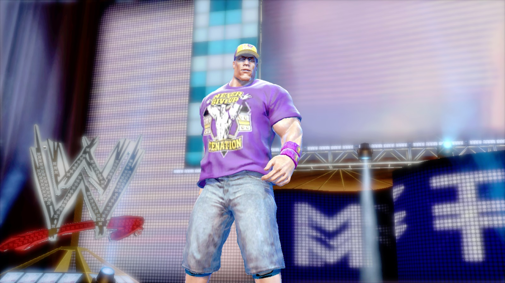
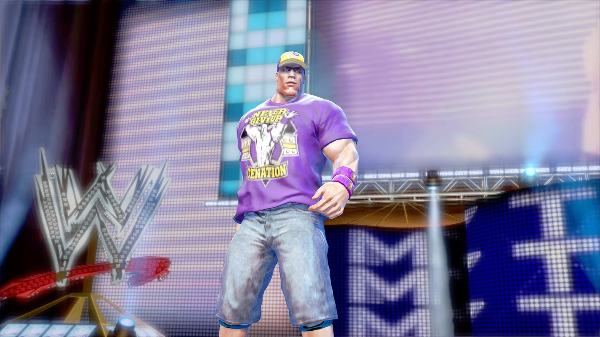
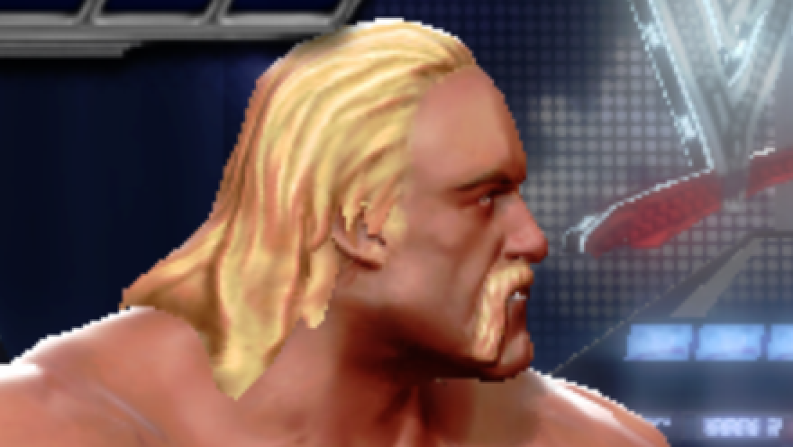
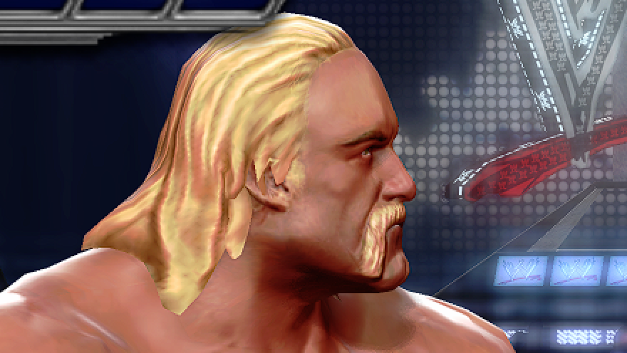
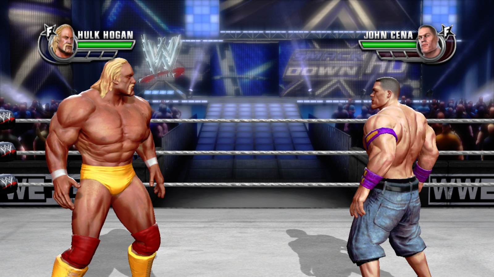
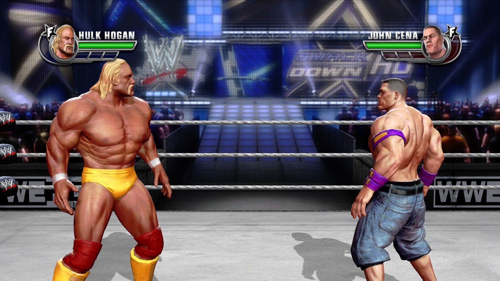

<p align="center">
  
</p>

An unofficial Windows version of WWE All Stars (Xbox 360, 2011). The game's PowerPC code
is translated ahead of time to native x86-64 with [ReXGlue](https://github.com/rexglue/rexglue-sdk),
and a native Vulkan renderer draws the game's own Direct3D 9 calls. It is not an emulator
you load a disc into: the game runs as a normal Windows program, and the launcher copies
the game files from your disc image once.

**This repository and its releases contain no game files.** You need your own Xbox 360
disc image of WWE All Stars (USA/Europe) and its Title Update 2, both dumped from your own
console. DLC is optional and comes from your console too. The launcher checks every file
and refuses anything else.

**[Download the latest release](../../releases/latest)** · [What works](#what-works) ·
[Install](#play-it) · [FAQ](#faq) · [Build from source](#build-from-source)

<!-- The 30 s teaser plays here: drag out/launch/WWE-AllStars-Recomp-teaser-720p.mp4 into
     GitHub's editor and put the github.com/user-attachments URL it gives on its own line. -->

<p align="center">
  <a href="https://youtu.be/aYn1RfyKkZc">
    
  </a>
  <br>
  <sub>The full match on YouTube, Chris Jericho vs CM Punk, recorded on Windows 11 with an RX 7900 XT</sub>
</p>

## What works

| | |
| --- | --- |
| Tested and playable | Exhibition 1v1 with entrances, finishers and the result screen; Path of Champions; Fantasy Warfare; Create a Superstar; 4 local players; DLC wrestlers (Million Dollar Pack); online Player Match |
| Tested hardware | Windows 11 with an AMD Radeon RX 7900 XT; Steam Deck on SteamOS through Proton, at 60 fps on the Low preset |
| Not tested yet | NVIDIA and Intel GPUs, Windows 10, desktop Linux |
| Not supported | Ranked Match and leaderboards; the in-game store (add DLC from the launcher) |

The game runs at its original 60 frames per second, on the Steam Deck too. Anything not
listed above may still crash; an [issue](../../issues/new/choose) with the
[crash report](#crash-reports) or session log attached helps fix it.

<table>
  <tr>
    <td width="50%"></td>
    <td width="50%"></td>
  </tr>
  <tr>
    <td></td>
    <td></td>
  </tr>
</table>

## What the PC version adds

### A native renderer

The Native renderer intercepts the game's Direct3D 9 calls and draws them with Vulkan,
instead of emulating the Xbox 360 GPU. It is the default. The emulated renderer from
ReXGlue stays available as Emulated, as a fallback and as a reference.

Native adds image options the console never had:

| Setting | Choices |
| --- | --- |
| Render resolution | 720p, 1440p, 2160p or 2880p, fitted to your window: above the window's size the picture is filtered down to it, which smooths jagged edges; below it, it is scaled up and sharpened. 1440p by default |
| Sharpening (AMD FidelityFX CAS) | Off, Low, Medium or High |
| Texture filtering | Anisotropic, up to 16x |
| Colour | Original, the Xbox 360's gamma curve as in Xenia, or Natural (sRGB), with more detail in dark areas |
| Graphics preset | Low, Medium, High or Ultra (2160p, 16x texture filtering, Sharpening Low). On first start the game suggests one for your GPU: Low for a Steam Deck or an integrated GPU, Medium for a small discrete GPU, High otherwise |

#### Next to the Xbox 360

<table>
  <tr>
    <th width="50%">Xbox 360 (720p)</th>
    <th width="50%">PC, highest settings</th>
  </tr>
  <tr>
    <td></td>
    <td></td>
  </tr>
  <tr>
    <td></td>
    <td></td>
  </tr>
  <tr>
    <td></td>
    <td></td>
  </tr>
  <tr>
    <td></td>
    <td></td>
  </tr>
</table>

<sub>The same frames of one exhibition match, entrance and bell, nobody touching a controller. Xbox 360: the console's
1280x720 picture from the Emulated renderer, which reproduces the console's GPU, scaled to
1440p the way a 1440p screen shows it. PC: release 1.6.0 with Render resolution 2880p
filtered down to a 2560x1440 window, 16x texture filtering and Sharpening Low. In each pair
the upper image is a detail of the lower one at 200 %, each pixel shown as a 2x2 block.</sub>

### Shaders built before you play

Setup converts the game's shaders once, then builds every pipeline the game is known to
use before the first match, on all CPU cores. On GPUs with graphics pipeline libraries, a
pipeline that wasn't built ahead is linked from prebuilt parts instead of compiled on the
spot. The game paces itself at an even 60 Hz, and with Lock to display on it times its
frames to your display when the refresh rate is a multiple of 60.

### Settings inside the game

Press **F4**, or click both sticks, to open the PC SETTINGS page over the game. It is also
a row in the game's own OPTIONS menu. Display mode, VSync, sharpening, texture filtering,
sound and vibration change at once; the rest apply at the next start. The launcher and the
game share one settings file.

### Enhanced vibration

The Xbox 360 game rumbles only for aerial hits. Enhanced vibration, the default, gives
every hit a pulse sized by the kind of move, plus finishers landing on you, slams to the
mat, your own hits connecting, reversals and critical health. Original keeps the console's
behaviour, and a strength setting scales both.

### 60 fps entrances

On the console, wrestler entrances and the arena intro run at 30 fps. The PC version
plays them at 60, crowd included. On by default; the GRAPHICS tab turns it off.

### Unlock everything

An option on the GAMEPLAY tab opens every wrestler, arena, attire, Create a Superstar
move, entrance and Fantasy Warfare match at once. Your save is never changed by it:
what you really earn while it is on is still saved, and turning it off (then
restarting) brings back your own progress.

### Faster starts

Two options on the GAMEPLAY tab, both off by default. Shorter loading screens cuts the
fixed waits before each match where nothing is loading, about 10 seconds, and does nothing
in online matches. Skip startup logos drops the THQ and WWE movies at boot, so the menu
comes about 12 seconds sooner. The disclaimer still shows.

### 120 fps matches (experimental)

An option on the GRAPHICS tab runs offline matches at 120 fps, on a 120 Hz or faster
display or with variable refresh. Menus and entrances keep their rates, and online
matches stay at 60. It is off by default: some moves can still look wrong at 120, such as
a wrestler briefly out of place on a running throw, and it needs a strong GPU.

### Online Player Match (experimental)


The game's own Xbox LIVE menus work again against a game server that stands in for Xbox
Live and THQ's servers. Player Match is the mode that works today. Turn it on in the
launcher, pick a player name, and choose Xbox LIVE > Player Match in the game. Matches
connect directly when they can and go through the server's relay when they can't, so
nobody has to open ports. You see the matches of players on the same release. The server
keeps your player name, an ID made for your install and your addresses, in memory only.
It is in [`server/`](server), and anyone can run one and point the launcher at it.

<br clear="right">

### DLC and Title Update 2

The port is built on Title Update 2, the game's last update, because the DLC wrestlers need
it. Add the DLC packs you bought on the launcher's DLC page; each pack is checked block by
block before it is installed.

### Mods

The launcher's Mods page installs mods from a zip, 7z, rar or folder, turns them on and off,
sets their load order and shows conflicts. Mods can replace packages, edit config and text,
and add new wrestlers in the roster's free slots. Your game files are never changed. With
online play on, only mods that change looks load. The [modding guide](docs/modding.md)
explains the format, and [`docs/example-mod`](docs/example-mod) is a commented example.

### A launcher that sets everything up

<table>
  <tr>
    <td width="50%"></td>
    <td width="50%"></td>
  </tr>
  <tr>
    <td></td>
    <td></td>
  </tr>
</table>

The launcher verifies your disc image and update, copies the game files and prepares
shaders and pipelines. It also repairs a damaged install, opens the newest log for a bug
report, makes desktop and Start menu shortcuts, picks the GPU and tells you when a new
release is out (it only checks, it never downloads).

Also: Alt+Enter switches between window and fullscreen, and F12 saves a screenshot next to
the session log.

## Play it

You need:

- Windows 10 or 11, 64-bit (tested on Windows 11)
- A graphics card with Vulkan support and an up-to-date driver
- About 8 GB of free disk space
- Your own WWE All Stars disc image (`.iso`), the USA/Europe Xbox 360 release
- Title Update 2 for it, dumped from your own console
- Optional: DLC packs you bought, dumped from your own console
- A controller is recommended

Steps:

1. Download the latest `WWEAllStarsRecomp-<version>-<commit>-win-x64.zip` from
   [Releases](../../releases/latest).
2. Extract the whole zip to a normal folder, for example `C:\Games\WWEAllStars`. Don't run it
   from inside the zip, and avoid `Program Files`.
3. Open `WWEAllStarsLauncher.exe`. If Windows SmartScreen says "Windows protected your PC",
   choose **More info**, then **Run anyway**. The launcher isn't code-signed, so this
   happens once.
4. Choose your `.iso` (or drop it on the window), then Title Update 2, and optionally DLC.
   Setup copies and verifies everything and prepares the shaders. It takes a few minutes and
   happens once. Your files are only read, never changed.
5. Choose **Play**.

**Where Title Update 2 is:** on your console's drive or USB stick, the file
`tu00000005_00000000` in `Content\0000000000000000\54510866\000B0000`, or a file whose name
starts with `TU_` in the console's `Cache` folder. The launcher also takes a folder with it
inside (a whole USB `Content` folder works) or a zip, 7z or rar.

**Updating:** extract the new zip over your folder; your settings, saves, mods and game
files stay where they are. To keep the old version, extract to a new folder instead and
copy `userdata` (your settings and saves) into it.

### Starting without the launcher

After the first setup, the game starts on its own: run `game\wweallstars.exe` from your
folder, from a desktop shortcut to it, or add it to Steam (Game Mode on a Steam Deck). It
finds the game files the launcher set up and uses the settings you chose in the launcher,
and its session logs go to the same `logs` folder. Before setup it only tells you to run
the launcher once. The launcher is still where you change settings, add DLC and repair an
install.

### Crash reports

When the game crashes, or the GPU stops working, the game saves a crash report: one zip
named `crash-<date and time>.zip` in the `logs` folder. A message tells you, and **Yes**
opens the folder with the zip selected. If you played from the launcher, its message after
the game ends has an **OPEN CRASH REPORT** button, and the next time it starts it shows the
reports you haven't opened yet. The launcher makes one for its own crashes too.

The zip holds the session log, your settings file, a small dump of the program's
threads and a note with the version, renderer, GPU and driver. It has no game
data and is small enough to attach on GitHub. Nothing is uploaded: attach it to a
[bug report](../../issues/new/choose) yourself. The log can contain folder paths that show
your Windows user name; check it before posting. The launcher keeps the last 10 reports.

### If something is off

| What you see | What to do |
| --- | --- |
| Motion isn't quite even | Turn on variable refresh (FreeSync or G-Sync) if your display has it, or use a refresh rate that is a multiple of 60 (60, 120, 240 Hz). On a 144 or 165 Hz display without variable refresh, frames alternate between 2 and 3 refreshes |
| Slow on a weak GPU | Pick the Low preset under GRAPHICS. Render resolution is the costly setting |
| The game started on Emulated | The launcher says why; Prepare shaders fixes the usual cause |
| The launcher says the GPU stopped working on Native | Your GPU or driver failed under the Native renderer. Choose **SWITCH TO EMULATED** to play on the Emulated renderer, and update your graphics driver. Please attach the [crash report](#crash-reports) to a bug report too |
| The launcher freezes, for example when you pick a file | Start it with `WWEAllStarsLauncher.exe --reduce-effects`, or turn on Settings > LAUNCHER > Reduce effects; it turns off the window's see-through backdrop and animations. Each step is written to `logs\launcher.log`; attach it to a bug report |
| Setup starts again after moving the folder | Releases up to 1.0.0 remember the game files by their full path. Delete `userdata\launcher-state.json` and the launcher finds the `gamedata` folder beside it again. Later releases handle a moved folder on their own |
| A crash | Attach the [crash report](#crash-reports) zip to a [bug report](../../issues/new/choose) |
| Wrong graphics, or a crash without a report | Choose Open logs in the launcher, zip the session folder it opens and attach it to a [bug report](../../issues/new/choose). A log can contain folder paths that show your Windows user name; check it before posting |

## FAQ

**Is this an emulator?**
No. The game's code was translated to x86-64 ahead of time and runs as a Windows program.
ReXGlue provides what the Xbox 360 would (the kernel, audio, input), and the Native renderer
replaces the GPU emulation. The Emulated renderer is still there as a fallback.

**Is this piracy? Where do I get the game?**
No game code or data is in this repository or its releases; the port only runs with a disc
image, update and DLC you dumped from your own Xbox 360, and the launcher checks them.
This project won't link to any download, so please don't ask for ISOs in the issues.

**How is it different from Xenia?**
Xenia emulates the whole console and translates the game's code while it runs. Here the
code is translated once, ahead of time, and the Native renderer draws the game's Direct3D 9
calls with Vulkan directly. Xenia's code still matters: ReXGlue's runtime and the Emulated
renderer come from it.

**Why do I need Title Update 2?**
On the disc version the game switches DLC loading off. Building on the update makes DLC
work, and it's the game's final version.

**Does it run on Steam Deck or Linux?**
Yes on the Steam Deck: add the launcher to Steam as a non-Steam game and run it through
Proton on SteamOS. It plays at 60 fps on the Low preset, which the game picks on a Deck by
itself. Desktop Linux hasn't been tested yet.

**Can I use ReShade?**
You can, at your own risk; the port doesn't ship or support it. ReShade works on the final
picture, so it also filters the in-game settings page, the achievement pop-ups and the
game's menus. It is unlikely to find the game's depth, so depth effects (ambient occlusion,
depth of field) may do nothing, and it may switch depth off by itself in online play. If
the game crashes or the GPU stops working with ReShade on, try without it before you report
it: the crash report can't tell its failures apart from the port's.

**Was AI used?**
Yes, a lot. I'm a software engineer, and most of the code and the docs were written with
Claude Code, an AI coding agent. I steered the work, played and tested every change, and
decided what ships. The measurements, investigations and decisions are written down in
[`docs/`](docs), so anyone can check them.

## Build from source

This is for developers. Players only need the release zip.

You need Visual Studio 2026 Build Tools (Desktop development with C++, which includes
CMake, Ninja and the Windows SDK), [PowerShell 7](https://learn.microsoft.com/powershell/scripting/install/installing-powershell-on-windows),
Python 3 and Git. Copy your disc image into the repository folder and Title Update 2's
`default.xexp` into `assets/` next to `default.xex`, then run these in PowerShell 7:

```powershell
# Pinned LLVM and ReXGlue, SHA-256 checked
pwsh ./scripts/bootstrap.ps1
# ReXGlue sources at the pinned revision, with this project's patches
pwsh ./scripts/prepare-vulkan.ps1

# Verify the disc and extract its files into assets/
python scripts/inspect_disc.py "WWE All Stars (USA, Europe).iso" --extract-all assets

# Translate the game's PowerPC code (base executable + Title Update 2) to C++
pwsh ./scripts/build.ps1 -Action Codegen
pwsh ./scripts/build.ps1 -Action Configure
pwsh ./scripts/build.ps1 -Action Build -Jobs 16

# The launcher, and the player zip in out/release/
pwsh ./scripts/build.ps1 -Action Launcher
pwsh ./scripts/package.ps1 -Jobs 8
```

The build accepts only the known executable (SHA-256 `521c2325…6892`) and Title Update 2
(`a6a45704…ed6a`). `package.ps1` fails if any game-derived file ends up in the zip.

<details>
<summary>Build variants and PGO</summary>

Flag variants build into their own folder (`out/build/<preset>-<name>-vulkan`) and change
only the recompiled code and the game; the defaults are what ships.

```powershell
pwsh ./scripts/build.ps1 -Action Configure -Variant v3o2 -CMakeArgs '-DWWE_GAME_ARCH=x86-64-v3'
pwsh ./scripts/build.ps1 -Action Configure -Variant thin -CMakeArgs '-DWWE_GAME_LTO=thin'
pwsh ./scripts/build.ps1 -Action Build -Variant thin -Jobs 10
pwsh ./scripts/capture.ps1 -Variant thin
```

PGO, trained on a route you play:

1. `pwsh ./scripts/build.ps1 -Action Configure -Variant pgogen -CMakeArgs '-DWWE_GAME_PGO_GENERATE=ON'`,
   then `-Action Build -Variant pgogen`.
2. Play the route on `out/build/win-amd64-relwithdebinfo-pgogen-vulkan/wweallstars.exe` (or
   `capture.ps1 -Variant pgogen`) and close it with the window's X. Each run adds its counters
   to `pgo-raw/` in that build folder; a killed game adds nothing.
3. `python scripts/pgo_profile.py merge out/build/win-amd64-relwithdebinfo-pgogen-vulkan/pgo-raw -o out/pgo/route.profdata`
4. Configure a variant with `-CMakeArgs '-DWWE_GAME_PGO_USE=<absolute path>/out/pgo/route.profdata'`
   (optionally with `-DWWE_GAME_LTO=thin`) and build it. A profile goes stale as the code
   changes, so retrain after codegen changes.

</details>

## How it works

1. `inspect_disc.py` reads the disc image and extracts `default.xex` and the game data.
   Codegen applies Title Update 2's patch to the executable.
2. ReXGlue translates the PowerPC code to C++. `wweallstars_manifest.toml` lists the
   functions its automatic pass misses, each with the evidence for it.
3. The generated code links against the ReXGlue runtime: the Xbox 360 kernel, audio, input
   and a Vulkan GPU backend derived from [Xenia](https://github.com/xenia-project/xenia).
4. The Native renderer in `src/native` hooks the game's statically linked Direct3D 9 and
   draws with Vulkan, using shaders converted by a patched
   [XenosRecomp](https://github.com/hedge-dev/XenosRecomp).
5. `patches/` holds this project's changes to the runtime and the shader converter:
   frame pacing, live settings, the online client, DLC content, Title Update loading and
   audio fixes among them. The build applies them.

The design decisions are in [`docs/adr`](docs/adr) and the investigations in
[`docs/research`](docs/research).

## Credits

- [ReXGlue](https://github.com/rexglue/rexglue-sdk), the recompiler and runtime this port is built on
- [Xenia](https://github.com/xenia-project/xenia), which ReXGlue's runtime and GPU backend come from
- [XenosRecomp](https://github.com/hedge-dev/XenosRecomp) by hedge-dev, the shader converter
- [wwe-svr2011-pc](https://github.com/KaikoClanworth1/wwe-svr2011-pc) by KaikoClanworth1, where the
  scripted input, the session script and parts of the shader converter and in-game settings
  patches started; used with the author's permission
- [nex-go](https://github.com/PretendoNetwork/nex-go) by Pretendo Network, which the game server uses
  for the game's online protocol
- AMD FidelityFX CAS, for sharpening
- Anton and Barlow Condensed (SIL Open Font License), the launcher's type
- [SVR2011-Recomp](https://github.com/shaneomac1337/SVR2011-Recomp), this project's sibling

## Legal

This project is not affiliated with or endorsed by WWE, THQ, Yuke's or Microsoft. This
repository contains no game code or data; the build generates the code from a disc image
you own. Do not share the `gamedata` or `updatedata` folders, a disc image, the update or
DLC packs.

The game and the launcher are under the BSD 3-Clause license in [`LICENSE`](LICENSE). The
game server in [`server/`](server) is under the AGPL-3.0 ([`server/LICENSE`](server/LICENSE)),
because of nex-go. ReXGlue's license is in [`third_party/`](third_party), and the release
zip carries the licences of every component in its `licenses` folder.
